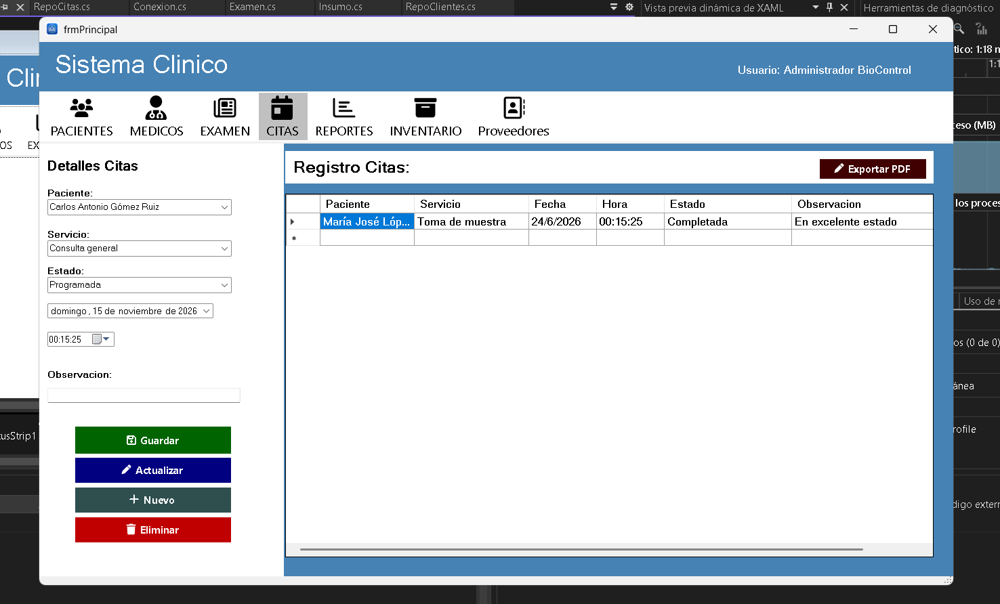
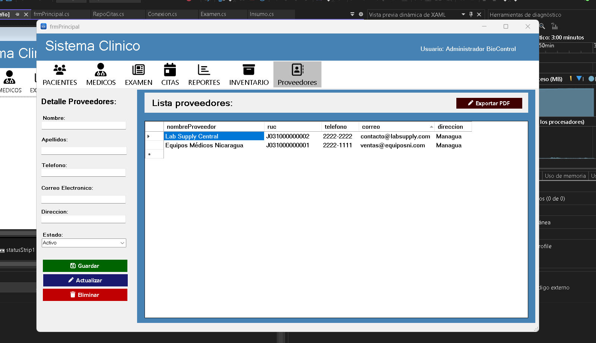
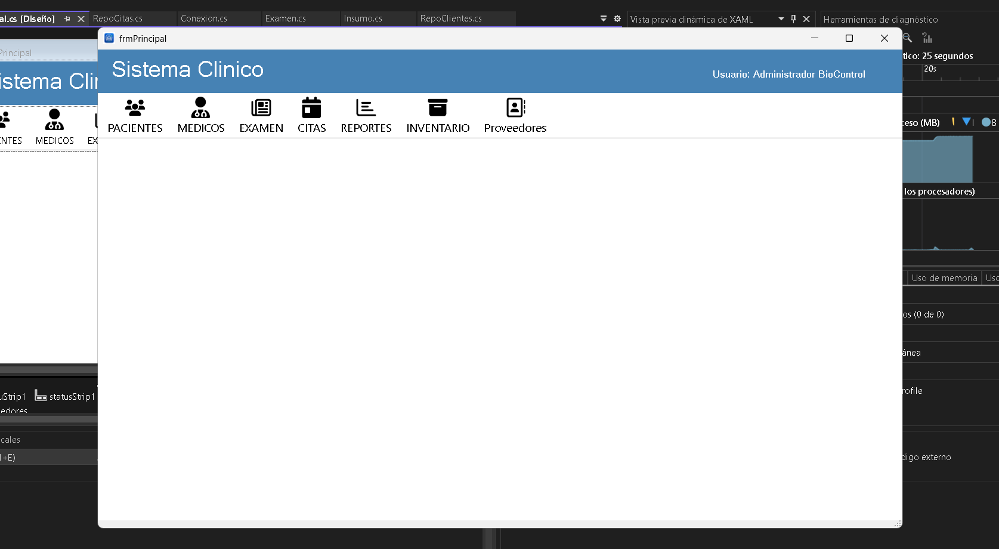

# BioControlLab

Sistema de escritorio en C# (Windows Forms) para gestionar un laboratorio clínico: pacientes, médicos, citas, exámenes, inventario, proveedores y reportes en PDF. Usa SQL Server como base de datos.

## Capturas

**Módulo de citas**


**Módulo de proveedores**


**Ventana principal**


## Funciones
- Gestión de pacientes, médicos y clientes
- Registro y seguimiento de citas con estado (programada, completada)
- Catálogo de exámenes e instrumentos
- Control de inventario de insumos y proveedores
- Exportación de reportes a PDF

## Estructura
```
app/                  Proyecto principal (WinForms)
BioControlLab.sln     Solución de Visual Studio
base-de-datos/        Scripts SQL para crear la base y sus relaciones
docs/                 Diagrama relacional y capturas
```

## Requisitos
- Visual Studio con .NET Framework
- SQL Server
- Restaurar los paquetes NuGet al abrir la solución

## Instalación
1. Ejecuta los scripts de `base-de-datos/scripts/` en SQL Server, en orden.
2. Ajusta la cadena de conexión en `app/App.config` a tu servidor.
3. Abre `BioControlLab.sln` y ejecuta el proyecto.
